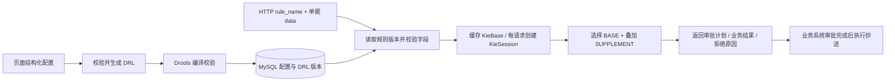

# 通用业务配置转 Drools DRL 的参考实现

本示例支持商品价格、订单及自定义业务类型，实现：页面 JSON 配置 → 校验 → 生成 DRL → 编译 → MySQL 发布版本 → 业务方传入 `rule_name` 和单据数据统一执行 → 返回审批计划及业务结果。使用 JDK 1.8.0_351、Spring Boot 2.7.18、Drools 7.73.0.Final；版本用于提供可复现示例。

所有入参、出参属性的用途、必填条件、取值格式与示例见[HTTP入参与出参说明](API_PARAMETERS.md)。对应Java模型的属性及共用基类属性均有中文Javadoc注释。共用模型、跨规则参数复用和MySQL版本保存方式见[参数共用说明](PARAMETER_REUSE.md)。

数据库只保留`rule_version`一张表，保存规则配置及所有历史版本，每个规则集的最大版本生效。执行日志由`RuleService`通过`log.info`输出，不写数据库。`rule_version`保留`creator_id`、`created_date`、`updater_id`、`updated_date`，时间由数据库初始化，`updated_date`随记录更新自动变化。当前示例未接入登录上下文，创建人和更新人ID使用指定默认值空字符串；接入登录体系后应由服务端写入用户ID。

数据库初始化使用`src/main/resources/schema.sql`，仅创建规则版本表。



## 通用配置与订单调用

`RuleConfig` 使用 `ruleName + businessType + fields + rules`。`businessType` 是自定义字符串，例如 `ORDER`、`SALES_PRICE`、`PURCHASE_ORDER`。字段类型支持数值、字符串、布尔、字符串数组；条件支持数值比较、集合匹配、存在性判断和 `ALL/ANY/NOT` 嵌套。动作支持自动通过、审批、抄送、拒绝及 `SET_RESULT` 输出固定业务结果。

`DrlGenerator.generate(RuleConfig)` 使用同一套条件与动作模板。销售价格配置可选择受控计算类型 `GROSS_MARGIN`，成本调价可选择 `COST_INCREASE`；输入字段由页面选择，计算公式由服务端固定实现，计算结果再参与区间规则及风控规则。品类、多个基础区间及风控配置都保存在同一 `rule_name` 的版本中。商品和订单都通过 `/api/rules/execute` 执行。旧版 `PriceRuleConfig` 仍可发布，未填写计算方式时按业务类型采用原公式。

完整订单配置见 [order-config.json](examples/order-config.json)，单据见 [execute-order.json](examples/execute-order.json)，实际生成的DRL见 [order.drl](examples/order.drl)，响应见 [result-order.json](examples/result-order.json)。通用字段、运算符、动作及合并语义见 [HTTP请求参数说明](API_PARAMETERS.md)。

```bash
curl -X POST http://localhost:8080/api/rules/order_approval/publish \
  -H 'Content-Type: application/json' --data-binary @examples/order-config.json

curl -X POST http://localhost:8080/api/rules/execute \
  -H 'Content-Type: application/json' --data-binary @examples/execute-order.json
```

订单执行请求：

```json
{
  "rule_name": "order_approval",
  "document": {
    "id": "ORDER-001",
    "data": {
      "orderAmount": 15000,
      "customerLevel": "VIP",
      "overdue": false,
      "tags": ["CROSS_BORDER"]
    }
  }
}
```

示例命中大额订单审批、跨境风险追加审批及VIP折扣输出：销售经理串行节点 → 财务与风控并行节点，审批后抄送业务领导；响应 `results.discountRate = 0.95`。若 `overdue=true`，返回 `plan.decision=REJECTED` 及 `reasons`。`SET_RESULT` 返回声明的常量，折扣应用、金额计算及审批流程由业务系统执行。

`BASE` 同时命中时取最高 `priority`，相同优先级取配置中第一条；`SUPPLEMENT` 全部叠加。审批顺序为基础规则在前、补充规则按优先级降序在后，同优先级按配置顺序。相同业务结果键由最高优先级有效规则赋值。页面不提交任意Java表达式或DRL源码。

## 页面选择多层业务属性

页面级联选择 `customer → address → province` 后，将 `customer.address.province` 同时写入 `fields.name` 和 `when.field`，`type=STRING`、比较常量例如浙江。业务方在 `document.data` 中传入 `customer.address.province` 对应的原始嵌套对象，引擎读取叶子值并比较；父节点无需单独声明。

也支持 `items[0].price` 等确定数组下标，路径缺失、类型和必填约束由服务端校验。配置及路径随规则版本保存，原始嵌套请求写入应用INFO执行日志。

见 [多层属性说明](NESTED_FIELDS.md)、[完整配置](examples/nested-order-config.json)、[请求示例](examples/execute-nested-order.json)。

## 共用入参、出参与版本快照

`ApiModels` 提取规则选择、单据调用、规则版本、执行结果、价格百分数及HTTP错误的共用属性，原有HTTP JSON结构继续使用。`ParameterDefinition` 同时表达 `fields` 业务入参和 `outputs` 业务出参，支持名称、类型、必填约束、中文用途说明和示例。

`parameterSources` 可以引用其他已发布规则的参数定义。发布时复制并合并定义、固定来源版本，把完整的 `fields + outputs + parameterSources + rules` 保存到现有 `rule_version.config_json`，对应DRL保存到同一行。执行时读取目标版本完整快照；来源规则更新不会改变已发布规则。实际参数值记录在应用INFO日志的 `input` / `result` 中。已有表无需新增列。

参考 [参数共用与存储说明](PARAMETER_REUSE.md)、[复用配置](examples/order-shared-config.json) 和 [完整快照](examples/order-shared-snapshot.json)。

## 图片的业务含义与示例假设

销售默认规则及两组自定义品类规则都有相同的四个基础区间和两条风控。本例因此生成18条销售 DRL 规则。成本规则另生成2条 DRL 规则。

|业务|条件|结果|
|---|---|---|
|销售基础|毛利率 ≤ 0%|采购+1 → 采购+2，串行|
|销售基础|0% < 毛利率 ≤ 5%|采购+1|
|销售基础|5% < 毛利率 ≤ 10%|自动通过|
|销售基础|毛利率 > 10%|采购+1 → 指定审批人，串行|
|销售风控|毛利率 ≤ -50%|审批通过后抄送风控人员、业务领导|
|销售风控|毛利率 ≥ 50%|追加采购+2串行审批；通过后抄送风控人员、业务领导|
|成本基础|上调幅度 ≥ 5%|采购+1 → 采购+2，串行|
|成本风控|上调幅度 ≥ 50%|审批通过后抄送风控人员、业务领导|

- 销售第2、3区间的下界来自按顺序划分区间的解释，确保不会重复命中。
- 自定义品类策略优先于默认策略；父子品类同时配置时，选择路径中最深的已配置品类。同一品类在多组策略中重复配置会被拒绝。
- 图片没有真实品类ID，使用 `CAT_1_3`、`CAT_2_3` 作为两组自定义品类占位符；指定审批人使用 `USER:DEMO_APPROVER`。应替换为实际ID。
- 图片没有配置成本上调幅度 < 5% 的处理结果，示例返回 `NO_MATCH`，由业务系统明确处理。
- 百分数值 `5` 表示5%，`0.05`表示0.05%。使用 `BigDecimal` 比较。
- `ROLE:PURCHASE_PLUS_1` 等为审批人选择器。业务系统需要结合单据、组织关系将其解析成真实人员；本例输出选择器。
- 价格规则按单据中的一个商品及其品类路径计算。商品明细按商品逐条调用通用执行接口；订单级汇总字段由业务方计算后放入订单data。
- 返回的是审批计划；串行、并行节点及审批完成后的抄送由业务流程系统执行。`ccAfterApproval` 不会在规则调用时发送消息。

## 文件

- `examples/sales-config.json`：图片销售配置，含默认规则、两组指定品类规则。
- `examples/cost-config.json`：图片成本配置。
- `examples/sales.drl`、`examples/cost.drl`：由生成器实际生成并编译验证的 DRL（测试后导出）。
- `examples/execute-sales.json`：HTTP执行请求。
- `examples/result-sales-50.json`：毛利率50%的审批计划。
- `examples/generic-sales-config.json`：通用规则模型的价格区间示例，演示受控毛利率计算。
- `examples/execute-sales.json`、`examples/execute-cost.json`：商品分别通过通用规则接口提交销售价和成本价的请求。
- `src/main/resources/schema.sql`：MySQL建表SQL。
- `RuleConfig.java`：通用入出参声明、参数来源、条件树和动作配置。
- `ParameterDefinition.java`：输入字段与业务输出共用的参数定义。
- `ParameterResolver.java`：发布时解析来源、合并参数、固定版本。
- `ApiModels.java`：接口共用参数和结果属性，附中文说明。
- `DrlGenerator.java`：通用条件树生成DRL，不含订单或价格判断分支。
- `ConfigValidator.java`：配置、字段路径和执行数据的类型、运算符及动作校验。
- `FieldPath.java`：解析多层对象属性和确定数组下标，读取原始JSON中的叶子值。
- `GenericFact.java`、`GenericRuleResult.java`：通用字段匹配与确定的结果合并。
- `PriceRuleConfig.java`、`PriceRuleAdapter.java`：兼容价格页面配置并转换为通用模型。
- `RuleConfig.Calculation`：受控公式选项；毛利率及成本上调幅度由服务端按配置字段计算。
- `DroolsEngine.java`：按DRL摘要缓存最多64个KieBase，使用独立ReleaseId编译，每次执行创建并释放独立KieSession。
- `RuleStore.java`：不可变历史版本、按最大版本读取生效规则。
- `RuleService.java`：规则执行及INFO级别的JSON执行日志。

## 执行日志

`/api/rules/execute`每执行一份单据，`RuleService`通过`log.info`记录一条规则执行日志。完成一次规则计算（包含自动通过、人工审批、拒绝和未匹配结果）输出一条“规则执行完成”日志，后面是单行JSON：

```text
规则执行完成 {"executionId":"本次执行UUID","documentId":"ORDER-001","rule_name":"nested_order_approval","version":1,"input":{"rule_name":"nested_order_approval","document":{"id":"ORDER-001","data":{"customer":{"address":{"province":"浙江"}},"orderAmount":15000}}},"result":{"executionId":"本次执行UUID","rule_name":"nested_order_approval","version":1,"policyId":null,"policyName":null,"plan":{"decision":"MANUAL_APPROVAL","approvalSteps":[{"order":1,"mode":"SERIAL","approvers":["ROLE:SALES_MANAGER"],"sourceRule":"nested_order_approval:local_customer"}],"ccAfterApproval":[],"matchedRules":["nested_order_approval:local_customer"]},"results":{"reviewRegion":"LOCAL"},"reasons":[]}}
```

日志包含`executionId`、`documentId`、`rule_name`、实际`version`、`input`和`result`；`executionId`继续返回给调用方，用于检索应用日志。日志的`input`保留原始嵌套请求；按商品批量处理时，每次通用接口调用输出一条日志。系统异常由`ApiErrors`记录ERROR日志。

默认输出到控制台。需要日志文件时，可在`application.yml`中设置`logging.file.name`，或由部署环境采集控制台日志；`example.rules.RuleService`的日志级别需允许INFO。日志保留周期由日志配置或采集平台管理。

已有数据库中的`rule_execution`不再被代码访问；本次修改没有连接或删除实际数据库表。需要删除已存在的表时，在目标数据库执行：

```sql
DROP TABLE IF EXISTS rule_execution;
```

## 页面如何提交配置

页面把名称、受控计算类型、计算字段、品类、区间边界、审批人、串并行模式和风控对象组织成一个规则集配置，参考完整示例。新增、修改、删除规则后提交整个规则集。

一条基础区间配置：

```json
{
  "id": "band2",
  "min": 0,
  "minInclusive": false,
  "max": 5,
  "maxInclusive": true,
  "autoApprove": false,
  "mode": "SERIAL",
  "approvers": ["ROLE:PURCHASE_PLUS_1"]
}
```

`min` / `max` 为 null 表示无穷边界；`autoApprove` 与人工审批人互斥；模式为 `SERIAL` 或 `PARALLEL`。销售区间必须连续且覆盖整个毛利率范围。风控比较符为 `LT`、`LE`、`EQ`、`GE`、`GT`。风控按照配置列表顺序叠加，审批通过后抄送对象去重。

`rule_name` 是一套规则集的调用标识，示例为 `sales_price`、`cost_price`，并非一条DRL的 `rule "..."` 名称。图中一张品类配置卡片是一个policy，其基础区间和风控会生成多条DRL。接口先选中一个policy，再执行该policy的基础及风控规则。

规则触发只收集结果，所有规则执行完成后统一合成审批计划，保证风控追加节点在基础审批节点之后。如果基础区间为自动通过且风控要求追加审批，最终结果为 `MANUAL_APPROVAL`。

## MySQL 与启动

先准备专用数据库 `rule_engine`，在其中执行 `src/main/resources/schema.sql`。示例不会自动创建或修改数据库。

设置数据库环境变量后启动：

```bash
export RULES_DB_URL='jdbc:mysql://localhost:3306/rule_engine?useUnicode=true&characterEncoding=UTF-8&serverTimezone=Asia/Shanghai'
export RULES_DB_USERNAME='your_user'
export RULES_DB_PASSWORD='your_password'
mvn spring-boot:run
```

使用 JDK 1.8.0_351 运行 Maven。本机可这样选择 JDK：

```bash
export JAVA_HOME=/Library/Java/JavaVirtualMachines/jdk1.8.0_351.jdk/Contents/Home
export PATH="$JAVA_HOME/bin:$PATH"
java -version
mvn -version
```

项目的 `java.version` 为 `1.8`，编译目标为 Java 8 字节码。数据类使用普通 Java 类及 Jackson 构造器注解；DRL 使用 Drools 7 的传统构建方式。

默认监听 `127.0.0.1:8080`。部署到现有系统时按其HTTP与数据库配置集成。发布接口应使用现有后台管理权限，执行接口使用现有业务调用权限。

## 发布与执行

从项目根目录执行：

```bash
curl -X POST http://localhost:8080/api/rules/sales_price/publish \
  -H 'Content-Type: application/json' \
  --data-binary @examples/sales-config.json

curl -X POST http://localhost:8080/api/rules/cost_price/publish \
  -H 'Content-Type: application/json' \
  --data-binary @examples/cost-config.json

curl -X POST http://localhost:8080/api/rules/execute \
  -H 'Content-Type: application/json' \
  --data-binary @examples/execute-sales.json
```

执行请求：

```json
{
  "rule_name": "sales_price",
  "document": {
    "id": "SO-1001",
    "categoryPath": ["CAT_X_1", "CAT_X_2", "CAT_X_3"],
    "grossMarginPct": 50
  }
}
```

成本请求使用 `rule_name: "cost_price"` 和 `document.costIncreasePct`。`categoryPath` 由一级到叶子排序，允许空列表表示默认策略。

毛利率50%时，返回基础审批加风控审批共三个串行节点：采购+1 → 指定审批人 → 采购+2；并附带 `ccAfterApproval`。返回 `executionId`、`rule_name`、`version`、`policyId`、`policyName` 和 `plan`。其中 `plan.decision` 为 `MANUAL_APPROVAL`、`AUTO_APPROVE` 或 `NO_MATCH`。

可读取当前配置及生成DRL：

```bash
curl http://localhost:8080/api/rules/sales_price
curl 'http://localhost:8080/api/rules/sales_price?version=1'
```

执行请求可增加 `"version": 1` 固定使用历史版本。未提供时读取当前生效版本；执行日志记录实际使用版本。

发布时先校验及编译，再在数据库事务中插入新版本。每个rule_name的最大版本为当前生效版本，历史版本不覆盖。并发发布通过行锁、复合主键及冲突事务重试分配版本号，每次最多尝试8个独立事务。失败的校验不会修改生效规则，缓存以DRL摘要区分版本内容。

## 验证

```bash
mvn test
```

测试使用H2的MySQL兼容模式和实际Drools编译/执行，覆盖销售与成本阈值边界、基础与风控叠加、品类选择、串并行节点、HTTP发布及执行、历史版本、非法配置、并发会话隔离、并发版本发布。测试还覆盖通用订单的AND/OR/NOT、全部运算符、优先级冲突、拒绝、自定义JSON结果、字段类型、十进制精度、常量转义、旧DRL兼容，并导出完整DRL及示例结果。共用参数测试还验证MySQL兼容存储中的完整参数快照、来源版本固定、来源更新/删除后的执行独立性、出参常量类型和运行时必填约束。多层属性测试覆盖页面选中路径、嵌套对象/数组、十进制精度、结构错误、缺失/null、路径语法、版本快照及原始请求日志。H2验证不等同于连接实际MySQL；接入目标数据库后需要验证建表和事务行为。

官方参考：[Drools 构建、部署与执行](https://docs.drools.org/7.73.0.Final/drools-docs/html_single/index.html#_kie)、[DRL语言参考](https://docs.drools.org/7.73.0.Final/drools-docs/html_single/index.html)。

Java 8 依赖兼容性参考：[Spring Boot 2.7.18 系统要求](https://docs.spring.io/spring-boot/docs/2.7.18/reference/htmlsingle/#getting-started.system-requirements)。

## 使用通用接口执行商品价格规则

商品价格、订单和其他业务都使用 `POST /api/rules/execute`。业务方按约定传入已发布的 `rule_name` 和单据数据；每个规则名下保存完整规则集，包括计算方式、多个基础区间规则、品类范围和风控配置。执行响应中的 `plan.decision` 是审批结论，`results` 是页面规则配置的业务出参，`matchedRules`列出实际采用的基础及风控规则。

销售毛利率计算选项 `GROSS_MARGIN`：`(salePrice - costPrice) / salePrice × 100`。成本调整幅度选项 `COST_INCREASE`：`(newCostPrice - originalCostPrice) / originalCostPrice × 100`。业务方传价格字段，不传计算结果；引擎按配置计算后再匹配规则。计算分母必须大于0，参与计算的另一价格不能小于0。页面只能选择受控选项，不能提交任意公式代码。

先发布同一规则集配置：

```bash
curl -X POST http://localhost:8080/api/rules/sales_price/publish \
  -H 'Content-Type: application/json' --data-binary @examples/sales-config.json
```

再传单个商品的原始价格：

```bash
curl -X POST http://localhost:8080/api/rules/execute \
  -H 'Content-Type: application/json' --data-binary @examples/execute-sales.json
```

请求中 `data.salePrice=100`、`data.costPrice=50`，服务端计算毛利率为50%，再按categoryPath选择策略并匹配该 `sales_price` 规则集中的区间和风控规则。`rule_name` 由业务方依据订单或商品场景选择；规则引擎不根据业务参数猜测规则名。

批量商品由业务方逐商品调用该通用接口，每次传同一个 `rule_name` 和对应单据数据；需要一组商品共享固定历史版本时，各次请求显式传相同 `version`。订单调用方式不变，字段放入 `document.data`，只须换成订单对应的 `rule_name`。
